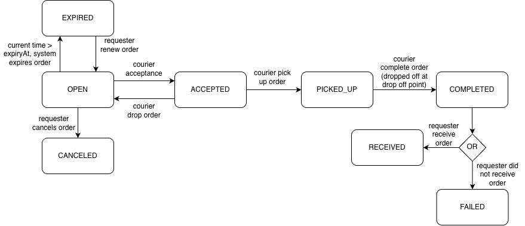

# Order Service

## Table of Contents

- [About](#about)
- [Features](#features)
- [Order Lifecycle](#order-lifecycle)
- [Asynchronous Workflows with RabbitMQ](#asynchronous-workflows-with-rabbitmq)
- [Background Workers](#background-workers)
- [Tech Stack](#tech-stack)
- [Architecture](#architecture)
- [Project Structure](#project-structure)
- [API Reference](#api-reference)
- [Getting Started](#getting-started)
- [Acknowledgements](#acknowledgements)

## About

The Order Service is responsible for order management and the order lifecycle for **Aaron**.

It uses authorisation and authentication from the User Service and publishes a OutboxEvent whenever another service needs to perform a follow-up action in response to an update to an order status.

In the Order Service, there are two main roles: Requester (user who created an order request) and Courier (user who accepted an open order request and is responsible for carrying out the request).

## Features

### Requester Features

- Create, update, cancel, and reorder requests
- View the requester’s order history with filtering, sorting, and pagination
- Renew an expired request by setting a new `expiryAt`
- Mark a completed order as received or report it as failed

### Courier Features

- Browse open requests not posted by the courier, with filtering, sorting, and pagination
- View accepted orders with filtering, sorting, and pagination
- Accept an open request
- Mark an accepted request as picked up
- Mark a picked-up request as completed

### Automatic Order Handling

- Expire open requests with no assigned courier when `expiryAt` passes
- Mark accepted or picked-up requests as failed if they have not reached `COMPLETED` by `expiryAt`
- Publish the corresponding credit event so Credit Service can release or return the reserved credits

## Order Lifecycle

### Order Lifecycle Diagram



### State Transitions

| From | Action and Conditions | To | Changed By | Trigger and Credit Operation |
| --- | --- | --- | --- | --- |
| NULL | Request is valid, expiry date in the future, pickup and delivery suppliers exist. | PENDING_RESERVATION | Requester ID | Request is submitted. Order Service creates the order, history row, and `CREDIT_RESERVATION_REQUEST` outbox row in one transaction. Credit reservation happens asynchronously. |
| PENDING_RESERVATION | Credit Service successfully reserves the requested credits. | OPEN | NULL (system) | Credit Service publishes an `CREDIT_RESERVATION_SUCCEEDED` outbox event.Order Service consumes it, records the reservation ID, and records the status change. |
| PENDING_RESERVATION | Credit Service cannot reserve the requested credits. | RESERVATION_FAILED | NULL (system) | Credit Service publishes an `CREDIT_RESERVATION_FAILED` outbox event. Order Service consumes it and updates the order to `RESERVATION_FAILED`. No credits are reserved. |
| OPEN | Requester owns the request, no courier is assigned, supplies exits, expected version matches, editable fields are valid, order must be in OPEN status. | OPEN | Requester ID | Requester updates the request. Offered credits cannot be changed after it is created. No change to credit reservations. |
| OPEN | No courier assigned, the user is not the requester, order has not expired, order must be in OPEN status. | ACCEPTED | Courier ID | Courier accepts the request. No change in credit reservations. |
| ACCEPTED | The user is the assigned courier,  order has not expired, order must be in ACCEPTED status. | OPEN | Courier ID | Courier drops the request. No change in credit reservations. |
| ACCEPTED | The user is the assigned courier,  order has not expired, order must be in ACCEPTED status. | PICKED_UP | Courier ID | Courier picks up the item. No change in credit reservations. |
| PICKED_UP | The user is the assigned courier,  order has not expired, order must be in PICKED_UP status. | COMPLETED | Courier ID | Courier marks delivery as completed. No change in credit reservations. |
| COMPLETED | The order belongs to the requester, order must be in COMPLETED status, a courier must be assigned, credit reservationId must exist, expected version matches. | RECEIVED | Requester ID | Requester confirms they received the item. Order Service publishes an `ORDER_RECEIVED` outbox event, triggering the credit service to transfer the reserved credits to the courier. |
| COMPLETED | The order belongs to the requester, order must be in COMPLETED status, a courier must be assigned, credit reservationId must exist, expected version matches. | FAILED | Requester ID | Requester reports that the delivery failed. Order Service publishes an `ORDER_FAILED` outbox event, triggering the credit service to refund the reservation. |
| OPEN | The order belongs to the requester, order must be in OPEN status, no courier is assigned, credit reservationId must exist, expected version matches. | CANCELED | Requester ID | Requester cancels the request. Order Service publishes an `ORDER_CANCELED` outbox event, triggering the credit service to release the reservation. |
| OPEN | The order must be in OPEN status, no courier has accepted it and expiryAt has passed. | EXPIRED | NULL (system) | The system’s expiry worker automatically expires the request. The expiry worker polls every 1 minute to check if any order has expired, and updates the order status accordingly. Order Service publishes an `ORDER_EXPIRED` outbox event, triggering the credit service to release the reservation. |
| EXPIRED | The order belongs to the requester, order must be in EXPIRED status, credit reservationId must exist, expiry date in the future, expected version matches. | EXPIRED | Requester ID | Requester requests renewal. Order Service set `renewalPending` to true and publishes a new `CREDIT_RESERVATION_REQUEST` outbox event. Credit Service attempts to create a new reservation. The existing expired status is retained while the reservation is pending. |
| EXPIRED | Credit Service successfully reserves the credits for the renewal attempt. | OPEN | NULL (system) | Credit Service publishes an `CREDIT_RESERVATION_SUCCEEDED` outbox event. Order Service consumes it, records the new reservation ID, updates the expiry date, and reopens the order. |
| EXPIRED | Credit Service cannot reserve the credits for the renewal attempt. | EXPIRED | NULL (system) | Credit Service publishes an `CREDIT_RESERVATION_FAILED` outbox event. Order Service consumes it, sets `renewalPending` to false and stores the renewal failure code. The order remains expired. |
| ACCEPTED | The order must be in ACCEPTED status, a courier must be assigned, and the expiry date has passed. | FAILED | NULL (system) | The system’s expiry worker automatically fails the request. The expiry worker polls every 1 minute to check if any order has expired, and updates the order status accordingly. Order Service publishes an `ORDER_FAILED` outbox event, triggering the credit service to refund the reservation. |
| PICKED_UP | The order must be in PICKED_UP status, a courier must be assigned, and the expiry date has passed. | FAILED | NULL (system) | The system’s expiry worker automatically fails the request. The expiry worker polls every 1 minute to check if any order has expired, and updates the order status accordingly. Order Service publishes an `ORDER_FAILED` outbox event, triggering the credit service to refund the reservation. |

For each transition, the order service performs the below in one database transaction:

- A conditional order creation/update: Checks if all requirements are fulfilled (e.g. pickupSupplierId != deliverySupplierId)
- Adding a new row to track the change in status in orderStatusHistory
- Creates an outbox event (if applicable)
  - An outbox event is a message to be sent/that has been sent to RabbitMQ.
  - A message is sent to RabbitMQ only after the transaction is committed. The outbox event is marked as published only after RabbitMQ confirms the message.

We use the expected version which comes from the payload and the current version for optimistic concurrency control.

## Asynchronous Workflows with RabbitMQ

The Order Service uses RabbitMQ for credit operations that do not need to complete before an order request is accepted by the API. It uses a transactional outbox so the order change and the message to publish are recorded together in the Order Service database.

### Creating an Order and Reserving Credits

1. The Order Service validates the request and synchronously verifies that the pickup and delivery suppliers exist.
2. In one database transaction, it creates the order with status `PENDING_RESERVATION`, records the initial status history, and creates a `CREDIT_RESERVATION_REQUEST` with an `CREATE` request type outbox row.
3. The Order Service outbox publisher sends the request to RabbitMQ. It marks the outbox row as published only after RabbitMQ confirms the message.
4. The Credit Service consumes the reservation request and attempts to reserve the credits. It records the outcome and creates a result outbox row in its own database transaction.
5. The Credit Service publishes either `CREDIT_RESERVATION_SUCCEEDED` or `CREDIT_RESERVATION_FAILED`.
6. The Order Service consumes the result and updates the order:
   - On success, it saves the reservation ID and changes the status from `PENDING_RESERVATION` to `OPEN`.
   - On failure, it records the failure code and changes the status to `RESERVATION_FAILED`.

The create API response means that the order was submitted. Its initial status is `PENDING_RESERVATION`; the final result is applied asynchronously.

### Renewing an Expired Order

When a requester renews an expired order, the Order Service validates the new expiry time and expected version. It then sets `renewalPending` and writes a `CREDIT_RESERVATION_REQUEST` with an `RENEW` request type to its outbox. The order stays `EXPIRED` while the Credit Service processes the request.

- On success, the Order Service saves the new reservation ID and expiry time, clears `renewalPending`, and changes the order from `EXPIRED` to `OPEN`.
- On failure, the order stays `EXPIRED`; the Order Service clears `renewalPending` and records the renewal failure code.

### Order Settlement Events

The Order Service also publishes these events after the corresponding order status change:

| Event | Credit Service operation |
| --- | --- |
| `ORDER_RECEIVED` | Transfer the reserved credits to the courier |
| `ORDER_CANCELED` | Release the reserved credits |
| `ORDER_EXPIRED` | Release the reserved credits |
| `ORDER_FAILED` | Refund the reserved credits |

For these transitions, the order, status-history row, and outbox event are written in the same Order Service transaction. The credit operation happens asynchronously after the event is published.

### Reliability and Duplicate Handling

The outbox publisher claims pending events, publishes them using RabbitMQ publisher confirms, and marks them published after confirmation. Failed publishes are retried with backoff. Events that exceed the retry limit are marked `DEAD` for inspection and manual redrive.

Messages can be delivered more than once. The Credit Service identifies repeated reservation requests by their event IDs. The Order Service records processed credit results in an inbox and checks that a repeated result has the same payload. A duplicate result therefore does not apply the order update twice.

RabbitMQ confirmation means the broker accepted the publish; it does not mean the receiving service has finished processing it. The receiving service acknowledges a message after its database work succeeds. Failed processing is retried or sent to a dead queue according to the consumer’s retry policy.

The publisher claims outbox rows inside a database transaction using `FOR UPDATE SKIP LOCKED`. The row lock prevents two publishers from claiming the same event at the same time. `SKIP LOCKED` lets a publisher skip rows another publisher has already claimed and continue with other available events. A lease on each claimed row lets another publisher reclaim it if the original publisher stops before finishing.

This prevents concurrent publishers from doing the same work, but it cannot guarantee that an event is published only once. For example, the publisher could receive RabbitMQ confirmation and stop before marking the database row as published. Consumers therefore still handle duplicate messages idempotently.

### Exchanges, Routes, and Queues

Order Service uses the durable topic exchange `foc.events`.

It publishes these events. The receiving queues are owned and declared by Credit Service.

| Order Service event | Routing key | Consumer |
| --- | --- | --- |
| `CREDIT_RESERVATION_REQUEST` | `credit.reservation.requested.v1` | Credit Service |
| `ORDER_RECEIVED` | `order.received.v1` | Credit Service |
| `ORDER_CANCELED` | `order.canceled.v1` | Credit Service |
| `ORDER_EXPIRED` | `order.expired.v1` | Credit Service |
| `ORDER_FAILED` | `order.failed.v1` | Credit Service |

Order Service consumes reservation results using this topology:

| Queue | Purpose |
| --- | --- |
| `order.credit-reservation-results.v1` | Receives reservation success and failure results, and delayed retry messages |
| `order.credit-reservation-results.retry.v1` | Holds messages for the configured 10-second retry delay |
| `order.credit-reservation-results.dead.v1` | Holds messages that need investigation or manual redrive |

The result queue binds to `credit.reservation.succeeded.v1`, `credit.reservation.failed.v1`, and `credit.reservation.result.retry.v1`. The retry queue dead-letters messages back to the shared exchange using the retry routing key after the delay.

These queues are durable quorum queues. They reject new publishes when full and disable the broker’s automatic delivery limit. The retry queue uses at-least-once dead-lettering, so a retry can be delivered more than once. The consumer must handle duplicate results idempotently.

### Dead-Letter Inspection and Redrive

Inspect queue counts without consuming messages:

```sh
docker compose exec rabbitmq rabbitmqctl list_queues -p / name messages_ready messages_unacknowledged consumers
```

Investigate the cause of a dead-lettered message before redriving it. Redrive republishes the original message for another processing attempt; it does not repair invalid data or change a reservation’s final state.

Stop Order Service while keeping RabbitMQ running, then for each workflow, run the redrive command with a positive limit. The command processes the oldest available dead letters, stopping at the requested limit or the number of ready messages counted at startup, whichever is smaller.

For credit reservation results message, run:

```sh
npm run redrive:credit-reservation-results -- --limit 10
```

For order outbox messages, run:

```sh
npm run redrive:order-outbox -- --limit 10
```

Redrive means sending a dead-letter message back for another processing attempt. The command only needs `RABBITMQ_URL`; it does not start Prisma or the HTTP server.

Restart order-service afterward. Keeping its consumer paused during redrive prevents a still-failing event from returning to the dead-letter queue and being picked up again in the same run. Run one redrive command at a time.

The command processes the oldest available dead letters. It stops at the requested positive limit or the number of ready messages counted at startup, whichever is smaller.

For each message, it:

- Preserves the exact event bytes, event ID, occurrence time and message ID.
- Resets `x-retry-count` to zero, increments `x-redrive-count`, and sets `x-redriven-at`.
- Keeps failure and death headers for diagnosis, but drops message expiration and AMQP user identity.
- Acknowledges the dead letter only after RabbitMQ confirms republication to the registration route.

A broker failure stops the command with exit code 1. The current unacknowledged message becomes available again when the connection closes. Invalid event bodies, identities or redrive counts also stop the command without removing the message. Investigate these separately; redrive does not rewrite events or repair accounts.

A crash after forwarding but before acknowledgment can create a duplicate delivery. The grant function still prevents a second grant. A successful redrive means the message was republished; order-service may not have processed it yet.

## Background Workers

### Order Deadline Worker

`expiryAt` is a deadline for an order to be completed. The Order Service runs a background worker that checks orders whose `expiryAt` deadline has passed. The deadline has different effects depending on the order’s current status:

| Current status | Condition | Result |
| --- | --- | --- |
| `OPEN` | No courier is assigned | `EXPIRED`; the requester can renew the order |
| `ACCEPTED` or `PICKED_UP` | Delivery has not reached `COMPLETED` | `FAILED`; the reserved credits are returned to the requester |
| `COMPLETED` | Delivery was completed by the deadline | No deadline transition |

For each matching order, the worker updates its status, sets `expiredAt` or `failedAt`, records the reason when it fails an order, and increments the order version. It also records a status-history entry and creates the corresponding outbox event in the same database transaction.

For an `OPEN` order with no assigned courier, the worker creates an `ORDER_EXPIRED` event. Credit Service consumes it and releases the reservation. For an `ACCEPTED` or `PICKED_UP` order that has not reached `COMPLETED`, the worker creates an `ORDER_FAILED` event. Credit Service consumes it and returns the reserved credits to the requester.

The worker polls every minute and runs immediately when the service starts. It is stopped during graceful service shutdown. Because status changes use conditional updates, a concurrent acceptance or completion cannot be overwritten by the worker. The acceptance, pickup, completion, and drop actions also check that `expiryAt` has not passed.

## Tech Stack

Technology    | Purpose
------------- | -----------------------------
Node.js       | Runtime environment
TypeScript    | Programming language
Express       | Backend web framework
Prisma        | ORM and database access
PostgreSQL    | Relational database
Zod           | Request validation
RabbitMQ      | Messaging
CORS          | Cross-origin resource sharing
Axios         | HTTP client for service-to-service calls
JWT           | Authentication tokens

## Architecture

### Overview Architecture Diagram

The Order Service is one of the backend microservices in Aaron.

```text
┌──────────────────────┐
│      Frontend        │
│   React + TypeScript │
└──────────┬───────────┘
           │
           │ REST API
           ▼
┌──────────────────────────────────────────────┐
│           Order Service                      │
│                                              │
│  ┌──────────────┐  ┌──────────────┐          │
│  │    Routes    │→ │ Controllers  │          │
│  └──────────────┘  └──────┬───────┘          │
│                           │                  │
│                    ┌──────▼───────┐          │
│                    │   Services   │          │
│                    └──────┬───────┘          │
│                           │                  │
│                    ┌──────▼───────┐          │
│                    │   Order      |          │
│                    │   Management │          │
│                    └──────┬───────┘          │
│                           │                  │     
│                    ┌──────▼───────┐          │
│                    │ Prisma ORM   │          │
│                    └───────┬──────┘          │
└────────────────────────────┼─────────────────┘
                             │
                             ▼
                    ┌──────────────────┐
                    │  PostgreSQL      │  
                    │  orders          │
                    └──────────────────┘
```

### Database

- PostgreSQL database
- Prisma ORM for database management

The Order Service has its own PostgreSQL database.

```text
Order Service
     │
     ▼
  PostgreSQL
     │
     ├── Order
     │
     ├── OrderStatusHistory
     │
     ├── OutboxEvent
     │
     └── CreditReservationResultInbox
```

Alongside these tables, enums `OrderStatus`, `OrderEventType`, `OutboxEventStatus` and `CreditReservationResultInboxStatus` are created.

To ensure concurrency, we use Prisma transactions, which make use of the database’s (Postgres) concurrency control mechanisms to ensure ACID (Atomicity, Consistency, Isolation and Durability) properties of the Order table.

Other microservices cannot directly access the Order Service database, as they are not on the same Docker internal network as the container running the Order Service's Postgres database. Cross-service references use the order's id and all data queries and updates have to go through the Order Service's exposed APIs.

### Supplier Service Verification

Before creating an order, the Order Service synchronously calls the Supplier Service to verify that the pickup and delivery supplier IDs exist. It also verifies any supplier IDs changed by an order update.

These internal calls use the `X-Order-Supplier-Service-Secret` header. The Order Service reads the secret from its environment and sends it with the request. The Supplier Service reads the matching secret from its own environment and compares it with the supplied header before allowing the request to continue. Requests with a missing or invalid secret are rejected.

This shared secret authenticates the Order Service as a trusted service; it is separate from the requester’s JWT. The requester’s identity is still used by the Order Service for user authorization, but the Supplier Service does not need the requester’s JWT to verify supplier records.

If supplier verification fails, the Order Service rejects the request before committing the order change. Supplier data is owned by the Supplier Service, so the Order Service stores supplier IDs rather than creating cross-service database relationships. Keep the secret out of source control and logs, and configure the same value securely in both services.

## Project Structure

```text
order-service/
├── prisma/
│   ├── migrations/
│   └── schema.prisma
│
├── src/
│   ├── config/
│   ├── controllers/
│   ├── errors/
│   ├── integrations/
│   ├── libs/
│   ├── middlewares/
│   ├── routes/
│   ├── schemas/
│   ├── scripts/
│   ├── services/
│   ├── types/
│   ├── workers/
│   └── index.ts
│
├── keys/
├── .dockerignore
├── .env
├── .env.example
├── .gitignore
|── AGENTS.md
|── compose.yaml
|── docker-entrypoint.sh
|── Dockerfile
|── package-lock.json
├── package.json
├── prisma.config.ts
|── README.md
└── tsconfig.json
```

## API Reference

### Order APIs

| Method | Route                             | Access Control         | Description                                            |
|--------|-----------------------------------|------------------------|--------------------------------------------------------|
| GET    | /api/orders                       | Authenticated users    | Gets all OPEN orders not posted by the caller          |
| POST   | /api/orders                       | Authenticated students | Create a new order                                     |
| GET    | /api/orders/me/requester          | Authenticated students | Gets all requests made by the authenticated requester  |
| GET    | /api/orders/me/courier            | Authenticated students | Gets all requests made by the authenticated courier    |
| PATCH  | /api/orders/:orderId              | Authenticated students | Update an existing order                               |
| POST   | /api/orders/:orderId/cancellation | Authenticated students | Requester cancels a specified open order               |
| POST   | /api/orders/:orderId/receipt      | Authenticated students | Requester marks a specfied completed order as received |
| POST   | /api/orders/:orderId/failure      | Authenticated students | Requester marks a specified completed order as failed  |
| POST   | /api/orders/:orderId/renewal      | Authenticated students | Requester renews a specified expired order             |
| POST   | /api/orders/:orderId/acceptance   | Authenticated students | Courier accepts a specified open order                 |
| DELETE | /api/orders/:orderId/acceptance   | Authenticated students | Courier drops a specified accepted order               |
| POST   | /api/orders/:orderId/pickup       | Authenticated students | Courier marks a specified accepted order as picked up   |
| POST   | /api/orders/:orderId/completion   | Authenticated students | Courier marks a specified picked-up orderas completed  |

--------------------------------------------------------------------------------

### `GET /api/orders`

Gets all OPEN orders not posted by the caller. The user can further specify the following:

- `page` (page number): server-side pagination is applied, default to `1`
- `sortBy`: category (either `offeredCredits` or `expiryAt`) to sort the records by, default to `expiryAt`
- `sortOrder`: order to sort the records by, default to `asc`
- `filterLocation`: location that the pickup supplier or delivery supplier must be
- `searchString`: name of an order that must contain the given `searchString`

```http
Authorization: Bearer <access-token>
```

#### Query Parameters

```text
?page=1&sortBy=expiryAt&sortOrder=asc&filterLocation=&searchString=
```

#### Successful Response

```json
{
    "success": true,
    "message": "Requester order history retrieved successfully",
    "data": {
        "orders": [ <full order information of all OPEN orders not posted by the caller> ],
        "pagination": {
            "page": 1,
            "limit": 15,
            "totalCount": 0,
            "totalPages": 1
        }
    }
}
```

#### Possible Responses

Status | Description
------ | -----------------------------------------------
`200`  | Orders successfully queried
`400`  | Invalid request data
`500`  | Internal server error

--------------------------------------------------------------------------------

### `POST /api/orders`

Creates a new order. The caller must be an authorised user with a `STUDENT` role.

```http
Authorization: Bearer <access-token>
```

#### Request Body

```json
{ 
    "name": "new test",
    "description": "new test order",
    "pickupSupplierId": "3017fe6a-3577-4918-bbaa-9d91455bc38f",
    "deliverySupplierId": "acb4a28a-6cc9-4190-9106-f68f65a05fa9",
    "offeredCredits": 3,
    "remarks": "",
    "expiryAt": "2026-10-23T15:53:00.000Z"
}
```

#### Successful Response

```json
{
    "success": true,
    "message": "Order created successfully",
    "data": { <full order information of the newly created order> }
}
```

#### Possible Responses

Status | Description
------ | -----------------------------------------------
`200`  | Orders successfully queried
`400`  | Invalid request data
`404`  | Invalid supplier id
`500`  | Internal server error

--------------------------------------------------------------------------------

### `GET /api/orders/me/requester`

Gets orders that have been created by the current user, with server-side pagination present.

```http
Authorization: Bearer <access-token>
```

#### Query Parameters

```text
?page=1&limit=15&status=OPEN&sortBy=createdAt&sortOrder=asc
```

#### Successful Response

```json
{
    "success": true,
    "message": "Requester order history retrieved successfully",
    "data": {
        "orders": [ <full order information of all orders created by the caller> ],
        "pagination": {
            "page": 1,
            "limit": 15,
            "totalCount": 1,
            "totalPages": 1
        }
    }
}
```

#### Possible Responses

Status | Description
------ | -----------------------------------------------
`200`  | Orders successfully queried
`400`  | Invalid request data
`500`  | Internal server error

--------------------------------------------------------------------------------

### `GET /api/orders/me/courier`

Gets orders that have been accepted by the current user, with server-side pagination present.

```http
Authorization: Bearer <access-token>
```

#### Query Parameters

```text
?page=1&status=OPEN&sortBy=createdAt&sortOrder=asc
```

#### Successful Response

```json
{
    "success": true,
    "message": "0 orders previously accepted by courier 5bb703e8-b4f5-4568-bb14-5a2bf9a392b0 retrieved",
    "data": {
        "orders": [ <full order information of all orders accepted by the caller> ],
        "pagination": {
            "limit": 15,
            "page": 1,
            "totalCount": 0,
            "totalPages": 0
        }
    }
}
```

#### Possible Responses

Status | Description
------ | -----------------------------------------------
`200`  | Orders successfully queried
`400`  | Invalid request data
`500`  | Internal server error

--------------------------------------------------------------------------------

### `PATCH /api/orders/:orderId`

Update an existing order, with the specified `orderId`

```http
Authorization: Bearer <access-token>
```

#### Example Request Body

```json
{ 
    "name": "new updated test"
}
```

#### Successful Response

```json
{
    "success": true,
    "message": "Order created successfully",
    "data": { <full order information of the updated order> }
}
```

#### Possible Responses

Status | Description
------ | -----------------------------------------------
`200`  | Orders successfully queried
`400`  | Invalid request data
`404`  | Invalid orderId specified
`500`  | Internal server error

--------------------------------------------------------------------------------

### `POST /api/orders/:orderId/cancellation`

Cancel an OPEN order with the specified `orderId`. This action can only be done by the requester.  

```http
Authorization: Bearer <access-token>
```

#### Request Body

```json
{ 
    "expectedVersion": 1,
    "cancellationReason": "don't need this anymore"
}
```

#### Successful Response

```json
{
    "success": true, 
    "message": "Order marked as canceled successfully",
    "data": { <full order information of the canceled order> }
}
```

#### Possible Responses

Status | Description
------ | ------------------------------------------------------------
`200`  | Orders successfully queried
`400`  | Invalid request data
`404`  | Invalid orderId specified
`409`  | Order does not satisfy conditions for it to be cancelled
`500`  | Internal server error

--------------------------------------------------------------------------------

### `POST /api/orders/:orderId/receipt`

Mark a completed order as received. This action can only be done by the requester.

```http
Authorization: Bearer <access-token>
```

#### Example Request Body

```json
{
    "expectedVersion": 4
}
```

#### Example Successful Response

```json
{
    "success": true,
    "message": "Order marked as received successfully",
    "data": { <full order information of the received order> }
}
```

#### Possible Responses

Status | Description
------ | ------------------------------------------------------------
`200`  | Orders successfully queried
`400`  | Invalid request data
`404`  | Invalid orderId specified
`409`  | Order does not satisfy conditions for it to be mark received
`500`  | Internal server error

--------------------------------------------------------------------------------

### `POST /api/orders/:orderId/failure`

Mark a completed order as failed. This action can only be done by the requester.

```http
Authorization: Bearer <access-token>
```

#### Example Request Body

```json
{
    "expectedVersion": 4,
    "failureReason": "did not receive item"
}
```

#### Successful Response

```json
{
    "success": true,
    "message": "Order marked as failed successfully",
    "data": { <full order information of the failed order> }
}
```

#### Possible Responses

Status | Description
------ | ------------------------------------------------------------
`200`  | Orders successfully queried
`400`  | Invalid request data
`404`  | Invalid orderId specified
`409`  | Order does not satisfy conditions for it to be mark as failed
`500`  | Internal server error

--------------------------------------------------------------------------------

### `POST /api/orders/:orderId/renewal`

Renews an expired request by changing the order status from EXPIRED back to OPEN. This action can only be done by the requester.

```http
Authorization: Bearer <access-token>
```

#### Query Parameters

```json
{
    "expiryAt": "2026-10-22T16:13:42.037",
    "expectedVersion": 2,
}
```

#### Successful Response

```json
{
    "success": true,
    "message": "Order renewed successfully",
    "data": { <full order information of the renewed order> }
}
```

#### Possible Responses

Status | Description
------ | ------------------------------------------------------------
`200`  | Orders successfully queried
`400`  | Invalid request data
`404`  | Invalid orderId specified
`409`  | Order does not satisfy conditions for it to be renewed
`500`  | Internal server error

--------------------------------------------------------------------------------

### `POST /api/orders/:orderId/acceptance`

Accepts an OPEN order. This action can be done by any authenticated student, except for the requester.

```http
Authorization: Bearer <access-token>
```

#### Successful Response

```json
{
    "success": true,
    "message": "Order e94ee4b9-2839-4fbd-b80e-89d1a324b96e accepted by courier bfef7411-c83b-4299-82b9-20ab9c52106f",
    "data": { <full order information of the accepted order> }
}
```

#### Possible Responses

Status | Description
------ | -----------------------------------------------------------------
`200`  | Orders successfully queried
`400`  | Invalid request data
`403`  | Caller does not have the permissions to perform this operation
`404`  | Invalid orderId specified
`409`  | Order does not satisfy conditions for it to be accepted
`500`  | Internal server error

--------------------------------------------------------------------------------

### `DELETE /api/orders/:orderId/acceptance`

Drop an ACCEPTED order. This action can only be done by the courier.

```http
Authorization: Bearer <access-token>
```

#### Successful Response

```json
{
    "success": true,
    "message": "Order e94ee4b9-2839-4fbd-b80e-89d1a324b96e dropped by courier bfef7411-c83b-4299-82b9-20ab9c52106f",
    "data": { <full order information of the dropped order> }
}
```

#### Possible Responses

Status | Description
------ | -----------------------------------------------------------------
`200`  | Orders successfully queried
`400`  | Invalid request data
`403`  | Caller does not have the permissions to perform this operation
`404`  | Invalid orderId specified
`409`  | Order does not satisfy conditions for it to be dropped
`500`  | Internal server error

--------------------------------------------------------------------------------

### `POST /api/orders/:orderId/pickup`

Mark an ACCEPTED order as PICKED_UP. This action can only be done by the assigned courier.

```http
Authorization: Bearer <access-token>
```

#### Successful Response

```json
{
    "success": true,
    "message": "Order e94ee4b9-2839-4fbd-b80e-89d1a324b96e picked up by courier bfef7411-c83b-4299-82b9-20ab9c52106f",
    "data": { <full order information of the picked up order> }
}
```

#### Possible Responses

Status | Description
------ | -----------------------------------------------------------------
`200`  | Orders successfully queried
`400`  | Invalid request data
`403`  | Caller does not have the permissions to perform this operation
`404`  | Invalid orderId specified
`409`  | Order does not satisfy conditions for it to be picked up
`500`  | Internal server error

--------------------------------------------------------------------------------

### `POST /api/orders/:orderId/completion`

Mark a PICKED_UP order as COMPLETED. This action can only be done by the assigned courier.

```http
Authorization: Bearer <access-token>
```

#### Successful Response

```json
{
    "success": true,
    "message": "Order e94ee4b9-2839-4fbd-b80e-89d1a324b96e completed by courier bfef7411-c83b-4299-82b9-20ab9c52106f",
    "data": { <full order information of the completed order> }
}
```

#### Possible Responses

Status | Description
------ | -----------------------------------------------------------------
`200`  | Orders successfully queried
`400`  | Invalid request data
`403`  | Caller does not have the permissions to perform this operation
`404`  | Invalid orderId specified
`409`  | Order does not satisfy conditions for it to be completed
`500`  | Internal server error

--------------------------------------------------------------------------------

### Error Response Format

Common error codes include:

Code                    | HTTP Status | Description
----------------------- | ----------: | ----------------------------------
`BAD_REQUEST`           |       `400` | Invalid request
`UNAUTHORIZED`          |       `401` | Authentication required or invalid
`FORBIDDEN`             |       `403` | Insufficient permissions
`NOT_FOUND`             |       `404` | Resource not found
`CONFLICT`              |       `409` | Resource already exists
`INTERNAL_SERVER_ERROR` |       `500` | Unexpected server error

### Response Shape

#### Success

```json
{ "success": true, "message": { /* message to be returned */ }, "data": { /* data to be returned */ } }
```

#### Errors

```json
{ "success": false, "code": "CONFLICT", "message": "..." }
```

## Getting Started

### Prerequisites

Make sure the following are installed:

- Node.js compatible with the project’s installed Prisma version.
- npm.
- PostgreSQL.
- Docker Desktop or another Docker Engine for local RabbitMQ.

### Environment Variables

Create a `.env` file in the root of the Order Service and fill in the required environment variables. You can use the provided `.env.example` as a template.

| Variable | Purpose |
| --- | --- |
`PORT` | Port used by the User Service
`NODE_ENV` | Node environment (development, production, etc.)
`FRONTEND_URL` | Frontend URL allowed by CORS
`SUPPLIER_SERVICE_URL` | URL of the Supplier Service
`CREDIT_SERVICE_URL` | URL of the Credit Service
`ORDER_POSTGRES_DB` | Name of the PostgreSQL database for the Order Service
`ORDER_POSTGRES_USER` | Username for the PostgreSQL database
`ORDER_POSTGRES_PASSWORD` | Password for the PostgreSQL database
`DATABASE_URL` | PostgreSQL connection string
`RABBITMQ_URL` | Broker connection URL for the background outbox publisher
`JWT_PUBLIC_KEY_PATH` | Path to the RSA public key used to verify access tokens
`ORDER_CREDIT_SERVICE_TOKEN` | Shared secret for internal Order → Credit requests
`ORDER_SUPPLIER_SERVICE_TOKEN` | Shared secret for internal Order → Supplier requests

> Do not commit `.env`, private keys, or other secrets to the repository.

### Database Setup

From the repository root:

```sh
cd order-service
npm ci
```

Apply the database migrations and generate the Prisma client:

```sh
npm run db:deploy
npm run db:generate
```

To inspect the database schema, run:

```sh
npm run db:studio
```

Start development with `npm run dev`, or run the compiled application with `npm start`.

The registration consumer starts after the HTTP server begins listening. It reconnects if RabbitMQ becomes unavailable. `GET /healthz` only confirms that the HTTP server is running; it does not check RabbitMQ or whether students have received credits.

### Containerization

The Order Service has been containerized with Docker. Use `docker compose up --build order-service` in the root folder to build only the `order-service` container and its dependencies `order-postgres` and `rabbitmq`.

However, building the Order Service container does not mean the API endpoints for the service can be called directly. The Order Service runs on the Docker `backend` and `order-db` networks, which are both internal networks. All calls to the Order Service must be done through the frontend proxy.

To go through the frontend proxy, go to the root folder `foc` and run `docker compose up --build`. Then from Postman or the browser's dev tools, add the Bearer authentication token, call `http://localhost:5173/api/orders` or the relevant order service endpoints.

## Acknowledgements

- [Express](https://expressjs.com/)
- [Prisma](https://www.prisma.io/)
- [PostgreSQL](https://www.postgresql.org/)
- [Zod](https://zod.dev/)
- [JSON Web Token](https://jwt.io/)
- [RabbitMQ](https://www.rabbitmq.com/)
- [Docker](https://www.docker.com/)
